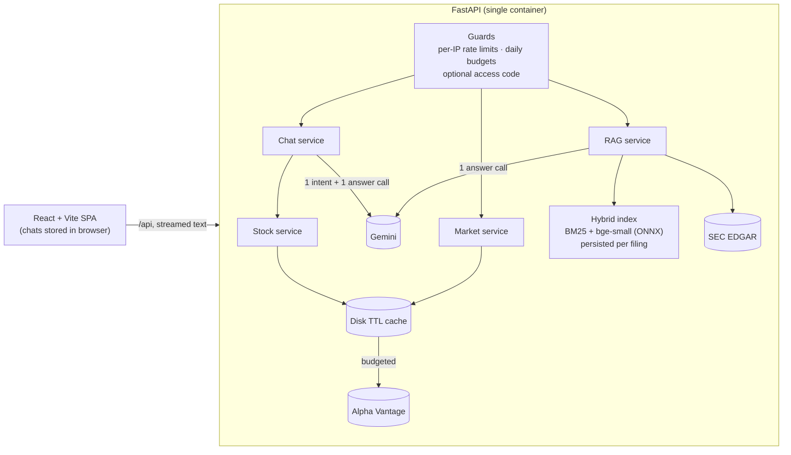

# StockBot — AI Financial Assistant with RAG over SEC Filings

StockBot is a full-stack AI assistant for the stock market:

- **Live market data.** Quotes, top gainers/losers, most-active tickers, news with sentiment and the IPO calendar, all from **Alpha Vantage**.
- **AI analysis.** **Google Gemini** classifies each question, resolves the company to a ticker, and writes answers grounded in freshly fetched data (price summaries, and bull/bear outlooks from fundamentals and technicals).
- **"Chat with a 10-K".** Type any US company and StockBot downloads its latest annual report from **SEC EDGAR**, indexes it, and answers questions with **cited sections**. You can also upload your own PDF/TXT/HTML.

> **Live demo:** _add your deployment URL here_ · no sign-up needed

---

## Architecture



### RAG pipeline

1. **Resolve** the company using the SEC's official ticker directory (free, no API quota).
2. **Fetch** the latest 10-K (or 20-F/40-F) from EDGAR. Strip the inline-XBRL metadata and convert tables into `a | b | c` rows so the numbers survive.
3. **Chunk** by section. Each chunk records its 10-K Item (e.g. *Item 1A. Risk Factors*, *Item 7. MD&A*), and that label is embedded with the text and shown as a citation.
4. **Embed** locally with `BAAI/bge-small-en-v1.5` through **fastembed/ONNX Runtime**, so no torch is needed and no API calls are made.
5. **Retrieve** with a **hybrid** search: dense cosine similarity plus BM25, merged with Reciprocal Rank Fusion. BM25 catches exact tokens like "AWS" or "2025"; dense search catches paraphrases.
6. **Answer** with one streamed Gemini call. The model is limited to the numbered excerpts, must cite them (`[2]`), and a *Sources* list is added to the reply.
7. **Persist** each index to disk, keyed by SEC accession number, so a filing is embedded once and later loads in milliseconds. The Docker build pre-indexes AAPL, AMZN, MSFT and NVDA.

### Built for a public demo (protecting API quotas)

| Protection | Default |
|---|---|
| Per-visitor (IP) rate limits | 6 chat msgs/min, 40/day · 5 new filings/day · 5 uploads/day |
| Global daily budgets (reset 00:00 UTC, persisted) | 300 Gemini calls · 25 Alpha Vantage calls · 20 new filings |
| Caching | Alpha Vantage responses cached on disk (quotes 30 min, fundamentals 24 h, market panels 12 h); stale data is served if a refresh fails |
| Cheaper call patterns | 2 LLM calls per chat message (was up to 5); prediction uses 2 Alpha Vantage calls (was 5); all market panels together use about 3 calls per refresh |
| Optional access code | Set `DEMO_ACCESS_CODE` to require a shared code (e.g. put it on your résumé) |
| Input limits | 1,000-char messages, 256 KB JSON bodies, 5 MB uploads, sanitized markdown rendering |

`GET /api/status` shows the remaining budgets, and the UI displays them.

---

## Run locally

**Prerequisites:** Python 3.11+, Node 20+, a free [Gemini API key](https://aistudio.google.com/apikey) and a free [Alpha Vantage key](https://www.alphavantage.co/support/#api-key).

```bash
git clone https://github.com/abdullahasif07/Stock-Bot.git && cd Stock-Bot
make install          # venv + pip + npm, and creates .env from .env.example
# edit .env and add GEMINI_API_KEY, ALPHA_VANTAGE_API_KEY and SEC_USER_AGENT
make dev              # API on :8001, UI on http://localhost:5173
```

Other commands: `make test` (offline unit and API tests), `make build`, `make docker-build && make docker-run`.

Interactive API docs are at `http://localhost:8001/docs`. Use another port with `make dev PORT=8010`.

---

## Deploy

The app ships as **one Docker image**: FastAPI serves both the API and the built React app, so there's no CORS setup and only one URL to share.

### Your own server: Docker + Caddy (what the live demo uses)
[`deploy/`](deploy/README.md) has a Compose file and a Caddy site config for running StockBot on a small VPS behind an existing Caddy reverse proxy, with automatic HTTPS and no published ports. GitHub Actions (`.github/workflows/ci.yml`) runs the tests, then builds the image and pushes it to GHCR only if they pass, then deploys it to the server over SSH, so the server never builds anything. See [deploy/README.md](deploy/README.md) for the step-by-step guide.

### AWS App Runner
```bash
aws ecr create-repository --repository-name stockbot
docker build --platform linux/amd64 -t stockbot .
docker tag stockbot <account>.dkr.ecr.<region>.amazonaws.com/stockbot:latest
aws ecr get-login-password | docker login --username AWS --password-stdin <account>.dkr.ecr.<region>.amazonaws.com
docker push <account>.dkr.ecr.<region>.amazonaws.com/stockbot:latest
```
Then create an App Runner service from that image with port `8000`, health check path `/api/health`, 1 vCPU / 2 GB, and the env vars from `.env.example`. Use `TRUSTED_PROXY_HOPS=1`.

### Fly.io / Railway / Google Cloud Run
Any container host works. Point it at the `Dockerfile`, expose `$PORT` (default 8000) and set the env vars. Run **a single instance**, because rate limits and budgets are kept in memory and on local disk.

### Vercel (frontend only)
Vercel can't run this backend (model size and long-lived processes). To host the UI there anyway:
1. Deploy the backend as above.
2. Import `react-frontend/` into Vercel and set `VITE_API_BASE_URL=https://your-backend-url`.
3. Set `CORS_ORIGINS=https://your-app.vercel.app` on the backend.

---

## Configuration

Every option is documented in [`.env.example`](.env.example). The main ones:

| Variable | Purpose |
|---|---|
| `GEMINI_API_KEY` | Google AI Studio key |
| `ALPHA_VANTAGE_API_KEY` | Market data |
| `SEC_USER_AGENT` | `"AppName you@email.com"`; SEC requires a contact address |
| `DEMO_ACCESS_CODE` | Optional shared code that gates every API call |
| `GEMINI_DAILY_LIMIT`, `AV_DAILY_LIMIT`, `FILING_INGEST_DAILY_LIMIT` | Global daily budgets |
| `CHAT_PER_MINUTE`, `CHAT_PER_DAY`, `RAG_INGEST_PER_DAY`, `UPLOAD_PER_DAY` | Per-visitor limits |
| `GEMINI_MODEL` | Defaults to `gemini-3.8-flash` |

## Project layout

```
backend/
  main.py              app, middleware, error mapping, SPA serving
  security.py          access code + per-IP sliding-window limiter
  routes/              HTTP layer (/api/chat, /api/market/*, /api/rag/*)
  services/            chat, stock, market, SEC EDGAR, RAG orchestration
  rag/                 chunking, ONNX embeddings, hybrid index
  utils/               Gemini client, Alpha Vantage client, disk cache, daily budgets
  prompts/             prompt templates
  scripts/prebuild.py  bakes model + popular 10-K indexes into the image
react-frontend/        React 19 + Vite SPA
tests/                 pytest suite (offline: embeddings & LLM are faked)
```

## API

| Method | Path | Description |
|---|---|---|
| POST | `/api/chat` | Chat. Streams text, or returns JSON choices when the ticker is ambiguous |
| POST | `/api/rag/initiate` | `{company}`: fetch and index the latest annual report |
| POST | `/api/rag/upload` | Multipart file: index your own document |
| POST | `/api/rag/query` | `{doc_id, question, history}`: streamed, cited answer |
| GET | `/api/market/{tickers,movers,news,ipos}` | Cached market panels |
| GET | `/api/status` | Integrations and remaining daily budgets |

*StockBot is for educational purposes only and does not give financial advice.*
